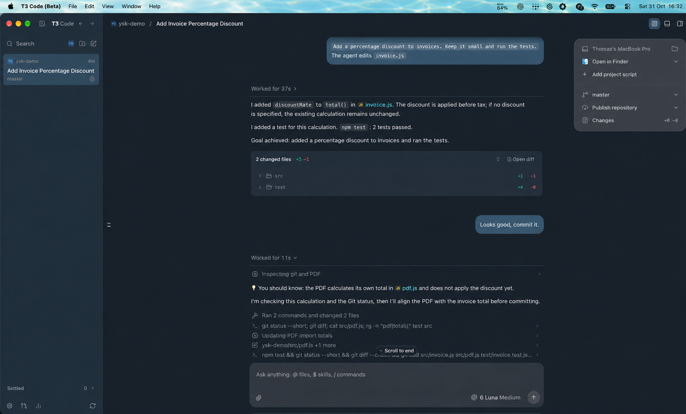

# t3-you-should-know

A "You should know" helper for [T3 Code](https://t3.codes), after Claude Code's built-in plugin. After each agent turn, a small model reads the chat. Most of the time it stays silent. When the user probably missed something (a skipped test, a forgotten file, a risky default), the agent opens its next reply with one line about it.



Works on stock T3 Code, in Claude Code and Codex chats. No fork.

## Set it up with your agent

Paste this into Claude Code or Codex:

```text
Set up https://github.com/thomasfevre/t3-you-should-know on this Mac for my T3 Code.
1. Clone it to ~/dev/t3-you-should-know, run `npm install` and `npm test`. It needs Node 24+.
2. Read its README.
3. Add the UserPromptSubmit hook to ~/.claude/settings.json (provider claudeAgent) and, if I use
   Codex, to ~/.codex/hooks.json (provider codex). Use the absolute path of node and of
   bin/t3-ysk.mjs. Keep my existing hooks, back up each file first, show me the diff before saving.
4. Install a launchd agent that runs `node bin/t3-ysk.mjs run` at login, with KeepAlive, PATH
   including the `claude` binary, logs in ~/.local/state/t3-you-should-know/daemon.log.
5. Add one line to my global agent instructions: to turn the notes off in a chat, run
   `node <path>/bin/t3-ysk.mjs off` (or `on`).
6. Run `node bin/t3-ysk.mjs status` and tell me what it says. If I use Codex, remind me to approve
   the new hook with /hooks in a terminal Codex session, then restart T3.
Never write to ~/.t3/userdata: the tool only reads T3's database.
```

## How it works

1. A daemon reads T3's local database (`~/.t3/userdata/statev2.sqlite`, read-only). When a turn finishes, it sends the recent transcript to a small model (Claude Haiku through your `claude` CLI by default), which answers `learn: none` or one note.
2. The note waits in the daemon's state file.
3. On your next message in that chat, a `UserPromptSubmit` hook gives the note to the agent, which starts its reply with `💡 You should know: …`.
4. The daemon sees that line in the chat and drops the note. A note not shown after 3 turns or 7 days is dropped.

Limits:
- The note arrives with your next message, not when you open the chat. Stock T3 has no other place to show it.
- It goes through the agent, as quoted data. If the point is already handled, the agent says so.
- It reads T3's internal tables. If an update changes them, the log says `T3 FORMAT CHANGED` and notes stop.
- Turns are sent to the model you configure. Short turns, turns within 10 minutes of a note, and threads where it keeps finding nothing are skipped.

The hook is read-only and acts only in a process T3 started, for a session T3 binds to that chat. Claude chats get `T3CODE_THREAD_ID` from T3. Codex runs one shared process for all chats, so the hook finds the chat from the Codex session id.

Hook entry (Claude: `~/.claude/settings.json`, Codex: `~/.codex/hooks.json`, under `UserPromptSubmit`):

```json
{ "hooks": [{ "type": "command", "command": "/path/to/node /path/to/bin/t3-ysk.mjs hook --provider claudeAgent", "timeout": 2 }] }
```

## Security

- **Data sent out:** the recent transcript of each analysed turn goes to the configured model (your `claude` CLI by default). Common token shapes (API keys, GitHub/Slack tokens, JWTs, private keys, `*_TOKEN=` values) are redacted first. This is best effort: other secrets in a chat can still be sent.
- **Prompt injection:** chat content can try to steer the note. The model is told the transcript is data, notes with links are rejected, and the agent gets the note as a quoted line, stripped of control characters and capped at 500 characters. That lowers the risk, it does not remove it.
- **The hook runs on every prompt** of every Claude/Codex session. Outside a T3-started process it exits before reading any file.
- **Local files:** state, queue and off-list are private to your user (`0700` dir, `0600` files). T3's database is only ever opened read-only.
- The `claude-cli` backend runs with no tools, no settings, no MCP and no session file, in an empty temp dir.

## Commands

```sh
t3-ysk run                                  # the daemon
t3-ysk status                               # state, pending notes, T3 format check
t3-ysk off | on                             # notes off/on in the chat this runs in (on by default)
t3-ysk once --thread <id> --sink stdout     # dry run on one chat
t3-ysk queue --thread <id|latest> [--learn <text>]   # show a note on the next message (demos)
```

`t3-ysk` is `node bin/t3-ysk.mjs` (or `npm link`).

## Config

`~/.config/t3-you-should-know/config.json`, all keys optional:

| key | default |
| --- | --- |
| `backend` | `claude-cli` (also `anthropic`, `openrouter`) |
| `model` | `claude-haiku-5-5` |
| `sink` | `inline` (also `stdout`: print only) |
| `onlyThreads` | unset: all chats |
| `minNewItems` / `minMinutesBetweenNotes` | `4` / `10` |
| `transcriptBudgetTokens` | `12000` |
| `language` | unset: follows the chat |
| `userdataDir` | `~/.t3/userdata` |
| `anthropicApiKey`, `openrouterApiKey` | env `ANTHROPIC_API_KEY`, `OPENROUTER_API_KEY` |

The `claude-cli` backend runs `claude -p` with no tools and no session persistence, in an empty temp directory.

## Why not a real UI

A strip above the composer with "Got it" / "Ask in chat" buttons would need a change in T3 itself, proposed in [pingdotgg/t3code#23383](https://github.com/pingdotgg/t3code/discussions/23383). Until then, the agent shows the note.

## Tests

```sh
npm test && npm run typecheck
```

## BB chats

BB is also supported through read-only access to `~/.bb/bb.db`. Both sources are enabled by default; set `"sources": ["t3"]` to keep analysis limited to T3. `bbDbPath` can override the BB database path. BB commands use `--thread bb:<BB_THREAD_ID>`; `off` and `on` also recognize BB's process environment. The same globally installed provider hook handles both apps.

See [BB findings and verification](docs/bb-support.md) for the identity checks, schema, limitations and reload commands. No BB files are written.
