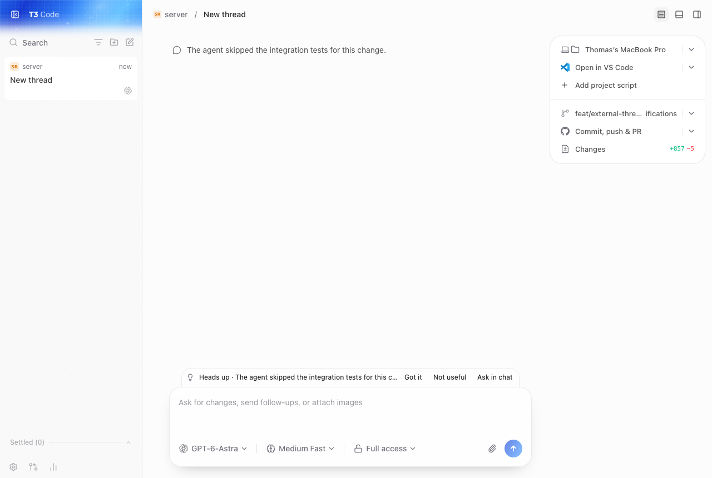
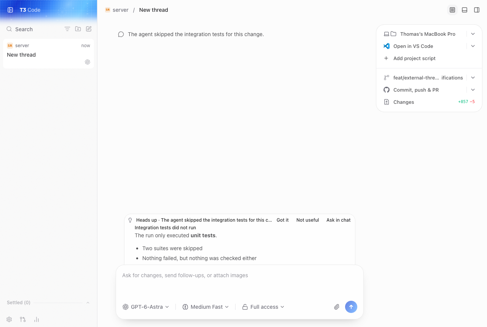

# t3-you-should-know

A side agent for [T3 Code](https://t3.codes), modelled on Claude Code's built-in "You should know" plugin. When an agent turn finishes, a cheap model reads the thread and either stays silent (`learn: none`, the default) or posts one short note that explains something the user probably missed.

## Install

Needs Node 24+ (it runs TypeScript directly, no build step).

```sh
git clone <this repo> && cd t3-you-should-know
npm install
node bin/t3-ysk.mjs status      # or: npm link, then `t3-ysk status`
```

## Use

```sh
t3-ysk once --thread <thread-id> --sink stdout   # dry run on one thread, prints the model output
t3-ysk run                                       # watch T3 and post notes
t3-ysk status
```

Thread ids are in `orchestration_v2_projection_threads` of `~/.t3/userdata/statev2.sqlite`, or `t3-ysk status` lists the latest ones.

## Config

`~/.config/t3-you-should-know/config.json`, all keys optional:

| key | default |
| --- | --- |
| `backend` | `claude-cli` (also `anthropic`, `openrouter`) |
| `model` | `claude-haiku-5-5` |
| `userdataDir` | `~/.t3/userdata` (CLI: `--userdata <dir>`, e.g. a dev T3 home) |
| `includeSubagentThreads` | `false` |
| `sink` | `t3` (also `macos`, `stdout`) |
| `transcriptBudgetTokens` | `12000` |
| `minNewItems` / `minMinutesBetweenNotes` | `4` / `10` |
| `language` | unset: follows the language the user writes in |
| `anthropicApiKey`, `openrouterApiKey`, `t3Token` | env `ANTHROPIC_API_KEY`, `OPENROUTER_API_KEY`, `T3_YSK_TOKEN` |

The `claude-cli` backend runs `claude -p` with no tools, no settings, no session persistence, in an empty temp directory, so it uses your Claude subscription and leaves no trace in your project history.

## How it talks to T3

- **Reading** (default): the local SQLite database `~/.t3/userdata/statev2.sqlite`, opened read-only. A run that reaches `completed` in `orchestration_v2_projection_runs` triggers an analysis; the transcript comes from `orchestration_v2_projection_turn_items`. Nothing is ever written to T3's data.
- **Posting**: the `t3` sink calls the MCP tool `t3_thread_notify` on `<origin>/mcp` (origin from `server-runtime.json`). The endpoint needs a bearer token: `t3 auth session issue --subject mcp-client --scope orchestration:read --scope orchestration:operate --ttl 30d --token-only`, then put it in `t3Token` (or `T3_YSK_TOKEN`). The `--subject mcp-client` part matters: the `/mcp` endpoint only accepts sessions issued for that subject, a session for the default subject is rejected with 401. Issuing a session writes to T3's own auth store, which is why this tool does not do it for you.
- **Feedback**: notes resolved as `acknowledged` ("Got it") are added to the avoid list; the daemon reads them back from the thread, matching by the `notificationId` returned by `t3_thread_notify` (summary text only as a fallback).
- `src/t3/ws.ts` (WebSocket RPC reader) is a documented stub; the sqlite poller makes it unnecessary.

## Status of the T3 patch dependency

`t3_thread_notify` and the notification `resolution` field do not exist in upstream T3 Code yet (a patch is in progress). Until it lands, the `t3` sink logs `not delivered (tool_missing | unauthorized)` once; the daemon retries a turn up to 3 times, then drops it. Use `--sink macos` or `sink: "macos"` to get native notifications in the meantime.

## Tests

```sh
npm test && npm run typecheck
```

## What it looks like

The note sits above the composer of the thread it concerns. Click the line to read the explanation.




